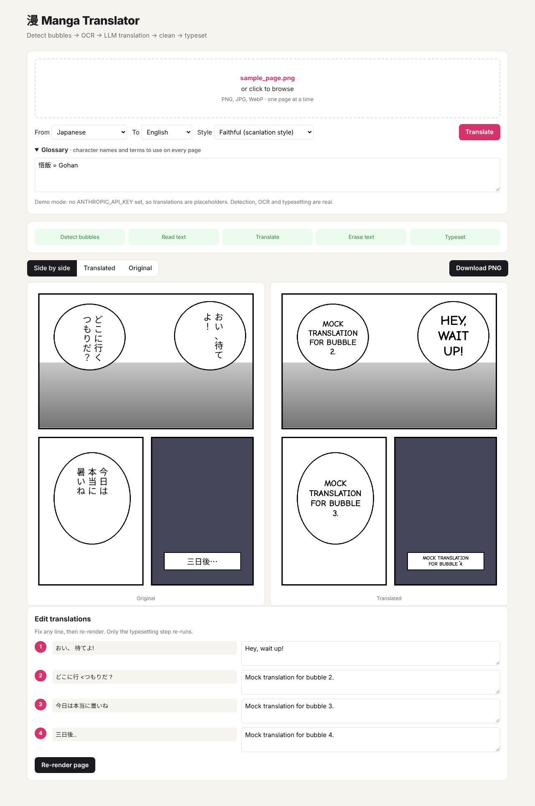

# Manga Translator

Upload a manga page, or a whole chapter as a ZIP, CBZ, EPUB, RAR or PDF. The app finds the speech bubbles, reads the Japanese, Chinese or Korean
text, translates it with Claude, erases the original lettering and typesets the
translation back into the bubbles. You can then fix any line by hand and re-render.



## How it works

```
upload ─▶ detect ─▶ OCR ─▶ translate ─▶ clean ─▶ typeset ─▶ review/edit
```

| Step | File | Approach |
|---|---|---|
| Detect | `pipeline/detect.py`, `pipeline/ctd.py` | [comic-text-detector](https://github.com/dmMaze/comic-text-detector), a model trained on manga pages, run with ONNX Runtime. It finds whole text blocks (vertical Japanese, hand-lettering next to screentone) and outputs a per-pixel text mask. Regions are sorted in manga reading order (right-to-left). EasyOCR's generic detector is the fallback. |
| OCR | `pipeline/ocr.py` | [manga-ocr](https://github.com/kha-white/manga-ocr) for Japanese if installed; otherwise EasyOCR. Vertical columns are cut into characters and laid out horizontally so EasyOCR can read them. |
| Translate | `pipeline/translate.py` | One Claude request per page. Claude gets the full page plus an image of every bubble with the OCR guess, reads the text itself (OCR on manga lettering is unreliable), and returns its reading plus the translation as JSON. Supports translation styles (standard / keep honorifics / faithful) and a glossary for names and terms. |
| Clean | `pipeline/clean.py`, `pipeline/inpaint.py` | Erases the masked lettering pixels. On white backgrounds they're repainted with the bubble color; over artwork the drawing is rebuilt with [LaMa](https://github.com/advimman/lama) (a manga/anime fine-tune, ~200 MB, downloaded on first use), run on small crops around the text. `INPAINTER=opencv` switches to OpenCV's instant but smeary inpainting. |
| Typeset | `pipeline/typeset.py` | Flood-fills the bubble to find its real size (or widens the text box when there's no closed bubble), binary-searches the largest font that fits after word wrapping, and draws centered ALL-CAPS text in Comic Neue (with an outline over artwork). |

The backend is FastAPI. Each page is a background job, and the frontend polls for
progress. Edits only re-run the typesetting step, using the saved cleaned image.

**Batch upload** (`archives.py`): several images and/or documents at once. Archives are
unpacked and PDFs rendered into pages in natural order (page2 before page10); each page
becomes a job, and the UI shows overall progress, a page strip to review/edit any page,
and a "Download all" ZIP.

**Languages:** source can be Auto-detect (Claude reads the bubbles and works out the
language; reading order is inferred from the layout), Japanese, Chinese (Simplified /
Traditional), Korean or English. 27 target languages, including Chinese, Japanese, Korean,
Russian, Thai, Arabic and Persian. `pipeline/fonts.py` picks a font that has every
character needed (bundled Comic Neue for Latin, then system fonts on Windows/macOS/Linux);
Chinese/Japanese wrap per character, Arabic/Persian are shaped right-to-left.

**Quality and cost:** each page is one Claude request. Pick **Economy** (Claude Haiku 5.5,
about $0.60 per 1,000 pages) or **Best quality** (Claude Sonnet 5.5, about $12 per 1,000
pages). Both run with up-front thinking off, since translation needs little reasoning and
thinking is billed as output. The app records the token counts each reply reports and shows
the estimated cost per page, per chapter and on the Dashboard (`backend/app/pricing.py`;
your Claude Console's Usage page has the exact bill).

**Chapters:** pages run on a pool of `WORKERS` threads (default 2), so detection, OCR and
erasing overlap. Translation is chained in page order: each page waits for the previous
one and gets the last two pages' dialogue as context, so names, terms and each
character's voice stay consistent across a chapter.

**Scan cleanup** (optional checkbox, `pipeline/enhance.py`): for low-quality raws.
Upscales small pages up to 2x, removes noise, evens out uneven lighting (estimated from
the paper only, so the art's shading survives), and sharpens. The cleaned page is what
gets translated.

**Webtoons / long strips:** images taller than 2.5× their width are detected slice by
slice (cut in the blank gutters between panels, or with overlap where there are none),
read top to bottom, and translated in chunks of 30 bubbles that each see the previous
chunk. The reader and slider show strips at full width with scrolling.
Test strip: `python samples/make_webtoon.py`.

**Accounts + dashboard:** sign up / log in (scrypt-hashed passwords, httponly session
cookies, SQLite in `data/app.db`). Every upload belongs to its user; other users get 404s.
The Dashboard lists your recent translations (open, download ZIP, delete), and everything
is deleted automatically after `RETENTION_DAYS` (default 10) by a background cleanup.

**Browser extension** (`extension/`, see its README): translates manga images in place on
the sites you read: hover button per image, "Translate all" (one batch, with page
context), and a right-click menu. It talks to your app with a personal key created on the
Dashboard (`Authorization: Bearer mtk_…`; one per user, revocable).

**Dark mode:** toggle in the header; follows the system setting until you choose.

Supported uploads: JPG, PNG, WebP, GIF, BMP, AVIF, HEIC · ZIP, CBZ, EPUB · RAR, CBR
(needs [7-Zip](https://www.7-zip.org/) or UnRAR installed) · PDF.

## Run it

```bash
python -m venv .venv && source .venv/bin/activate     # Windows: .venv\Scripts\activate
pip install -r requirements.txt
cp .env.example .env        # add your ANTHROPIC_API_KEY
uvicorn backend.app.main:app --reload
```

Open http://localhost:8000. The first run downloads the manga text detector (~95 MB, into
`models/`) and the EasyOCR models (~100 MB).
Without an API key the app runs in demo mode: detection, OCR and typesetting are real,
and translations are placeholders.

Better Japanese OCR: `pip install manga-ocr` (it's picked up automatically).

Lettering styles: Manga ([Comic Neue](https://comicneue.com/)), Action (Bangers),
Handwritten (Patrick Hand) and Clean (system sans). The fonts are bundled under the SIL
Open Font License (see `fonts/licenses/`); text a font can't draw falls back to a system
font. Pick a style before translating, or change it per page in the editor. To use your
own font, put it at `fonts/comic.ttf` (replaces Manga) or set `FONT_PATH`.

**Viewer:** side by side, translated, original, or a drag **slider** to compare the two;
**⛶ Read** opens a fullscreen reader (← → to flip, hold O to peek at the original, Esc to close).

Test page: `python samples/make_sample.py` generates `samples/sample_page.png`
(synthetic, so there's no copyright issue for demos).

## Tests

```bash
pytest -m "not slow"   # fast unit tests
pytest                 # includes an end-to-end run on the sample page
```

## API

| Method | Path | |
|---|---|---|
| `POST` | `/api/auth/signup`, `/api/auth/login`, `/api/auth/logout` | JSON `{username, password}`; sets the session cookie |
| `GET` | `/api/auth/me` | Current user (401 if logged out). All endpoints below need a login (cookie) or an extension key (`Authorization: Bearer`). |
| `POST` / `DELETE` | `/api/auth/api-key` | Create (replace) / revoke your extension key. Website login only. |
| `GET` | `/api/config` | Supported languages, translator mode |
| `POST` | `/api/jobs` | multipart: `file`, `source_lang`, `target_lang`, `style`, `glossary` → job |
| `POST` | `/api/batches` | multipart: `files` (repeat), same options → batch of page jobs |
| `GET` | `/api/batches/{id}` | Progress (`done` / `total`) and each page's status |
| `GET` | `/api/batches` | Dashboard: your batches, newest first, with expiry times |
| `DELETE` | `/api/batches/{id}` | Delete a batch and its pages |
| `GET` | `/api/batches/{id}/download` | ZIP of all translated pages |
| `GET` | `/api/jobs/{id}` | Status, current stage, regions (source and translated text, boxes) |
| `GET` | `/api/jobs/{id}/image/{original,translated,cleaned}` | PNG |
| `PUT` | `/api/jobs/{id}/translations` | `{"translations":[{"id":0,"text":"..."}]}` → re-render |

## Roadmap

- [x] Batch: ZIP/CBZ/EPUB/RAR/PDF upload, split into pages, download as ZIP
- [x] Manga-specific text detector (comic-text-detector)
- [x] Claude reads bubble images (vision) instead of trusting OCR
- [x] Translation styles + glossary
- [x] 27 target languages + auto-detect source
- [x] Dark mode
- [x] Accounts, dashboard, 10-day auto-delete
- [x] Context across pages + parallel processing
- [x] Before/after slider, reader, font picker
- [x] Webtoon long-strip support
- [x] Scan cleanup + LaMa inpainting
- [x] Browser extension (Chrome / Edge / Firefox)
- [ ] Optional cloud storage (Cloudflare R2 / Backblaze B2)
- [ ] Font style choices
- [ ] Drag/resize text boxes in the editor
- [ ] Docker + deploy (backend on a GPU host, frontend static)

## Known limitations

- Without an API key, translations are placeholders and the source text is EasyOCR's
  guess, which is weak on manga lettering. With a key, Claude reads the bubble images.
- Only use pages you have rights to in public demos.
